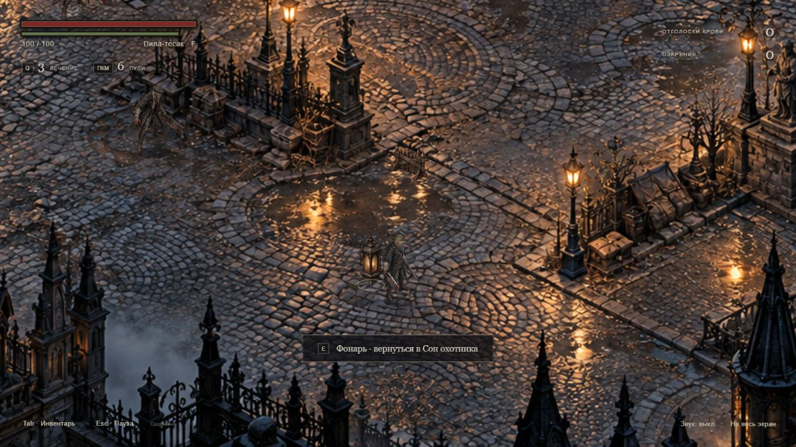

# Bloodborne: The Last Hunt

Неофициальная учебная 2D action-RPG: изометрический мир, исследование, сражения и история охотника, восстанавливающего потерянную память.

В игре три региона — Центральный Ярнам, Соборный округ и Кошмар Менсиса — и отдельный Сон охотника. Есть две формы оружия, парирование пистолетом, Озарение, развитие характеристик, три слота сохранения и сюжетные решения.



## Запуск

**Windows:** дважды нажмите `1 - ЗАПУСТИТЬ ИГРУ.bat`. Откроется локальная игра. Устанавливать дополнительные пакеты не нужно: если Node.js отсутствует, используется встроенный PowerShell-сервер.

**Другие системы или запуск из терминала:** нужен Node.js.

```sh
node scripts/server.mjs
```

Откройте [локальную игру](http://127.0.0.1:4186/). При запуске в терминале сервер останавливается через Ctrl+C. Двойной щелчок по `index.html` не подходит: ES-модули загружаются через HTTP.

Инструкция публикации: [docs/PUBLISHING.md](docs/PUBLISHING.md).

## Управление

| Клавиша | Действие |
|---|---|
| WASD / стрелки | Движение |
| Shift | Бег |
| Пробел | Перекат |
| R / Alt | Рывок |
| Ctrl | Скольжение во время движения |
| ЛКМ | Обычный удар; удержание — сильный |
| ПКМ | Выстрел и парирование |
| F | Трансформация пилы |
| Q | Лечение |
| E | Взаимодействие |
| Tab / I | Инвентарь и записи |
| Esc | Пауза |

Звук включается кнопкой внизу справа. При потере фокуса игра останавливается. Сохранения хранятся в браузере и привязаны к адресу игры.

## Файлы проекта

| Путь | Назначение |
|---|---|
| `index.html`, `style.css` | Игровой экран и оформление |
| `js/` | Симуляция, регионы, история, навигация, отрисовка и ввод |
| `assets/raster/` | Используемая графика и границы кадров |
| `scripts/` | Локальные серверы и запуск |
| `tests/` | Проверки игровой логики |
| `docs/` | Инструкция публикации, проверка и игровой кадр |

Файлы `hunter.frames.json` и `regional-enemies-atlas.json` используются во время игры. Их нельзя удалять.

Чистый JavaScript, Canvas, ES-модули и Web Audio. Установка npm-пакетов и сборка не требуются.

## Проверки

Для проверок нужен Node.js:

```sh
node --test tests/*.test.mjs
```

36 регрессионных проверок проходят. Подробности: [docs/TESTING.md](docs/TESTING.md).

## Состояние сборки

Регионы компактны: это текущая играбельная версия, а не завершённая многочасовая игра. Полное ручное прохождение, окончательный баланс и тестирование на физических телефонах ещё требуют проверки. Графика преимущественно статическая, часть действий собирается из отдельных поз.
